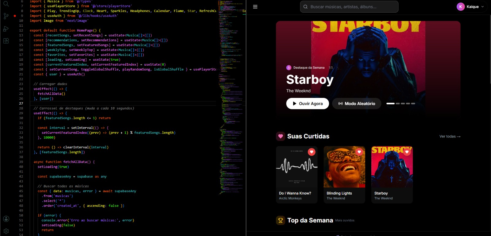

# WaveMusic 🎵

A full-stack music streaming platform built with Next.js 14, TypeScript, and Supabase — featuring authentication, playlists, favorites, listening history, and a persistent audio player with shuffle/repeat logic and PWA support.

**🔗 Live demo:** [wave-music-six.vercel.app](https://wave-music-six.vercel.app/)
**📦 Repository:** [github.com/kaiquesmendes/WaveMusic](https://github.com/kaiquesmendes/WaveMusic)



## Overview

WaveMusic is a Spotify-inspired streaming app where users can sign up, browse and search a music catalog, build playlists, favorite tracks, and pick up their listening history — all backed by a real Postgres database and a persistent global audio player that keeps playing across page navigation.

I built this to go deeper than a typical CRUD project: the audio player alone required solving real state-management problems (see [Technical Highlights](#technical-highlights) below).

## Features

- **Authentication** — sign up / log in via Supabase Auth, session handled through Next.js middleware
- **Global audio player** — persistent playback across routes, play/pause, seek, volume, next/previous, shuffle, repeat, and a "global shuffle" mode that samples across the entire catalog
- **Search** — real-time search by track title or artist
- **Playlists** — create, populate, and manage custom playlists
- **Favorites** — like/unlike tracks, dedicated favorites view
- **Listening history** — tracks are logged as the user plays them
- **Explore & Library** — browse by genre, recently added, and weekly highlights
- **PWA-ready** — installable app manifest and iOS-specific styling
- **Responsive UI** — Tailwind CSS, custom UI components (modals, skeleton loaders, glass-morphism cards)

## Tech Stack

| Layer | Technology |
|---|---|
| Framework | Next.js 14 (App Router) |
| Language | TypeScript |
| Styling | Tailwind CSS |
| State management | Zustand |
| Backend / DB | Supabase (PostgreSQL + Auth) |
| Audio engine | Howler.js |
| Forms & validation | React Hook Form + Zod |
| Deployment | Vercel |

## Technical Highlights

A few decisions worth pointing out in an interview:

- **Zombie-callback protection in the audio player.** Howler instances are created and destroyed on every track change. To prevent an old, already-destroyed instance from firing a stale `onend` callback and skipping two tracks at once, every player instance is tagged with an incrementing `_playToken`; callbacks check the token before acting on state.
- **Shuffle without repetition.** Instead of pure random selection (which can replay the same song back-to-back), the player keeps a history of recently played track IDs per shuffle session and excludes them from the candidate pool until the pool is exhausted, then resets.
- **Autoplay-policy handling.** Browsers block audio autoplay without a user gesture; `onplayerror` listens for Howler's `unlock` event to resume playback as soon as the user interacts with the page, instead of silently failing.
- **Bounded error recovery.** If a track's audio URL fails to load, the player automatically skips to the next track — but caps consecutive failures so a run of broken links can't trigger an infinite skip loop.

## Database Schema

PostgreSQL (via Supabase), 6 tables: `usuarios`, `musicas`, `playlists`, `playlist_musicas`, `favoritos`, `historico`, with foreign keys and indexes on the columns used for lookups and ordering (artist, genre, user favorites, playback history). Full schema in [`banco de dados.sql`](./banco%20de%20dados.sql).

## Running Locally

```bash
git clone https://github.com/kaiquesmendes/WaveMusic.git
cd WaveMusic
npm install
```

Create a `.env.local` file in the project root:

```
NEXT_PUBLIC_SUPABASE_URL=your_supabase_project_url
NEXT_PUBLIC_SUPABASE_ANON_KEY=your_supabase_anon_key
```

Then set up the database by running [`banco de dados.sql`](./banco%20de%20dados.sql) in your Supabase project's SQL editor.

```bash
npm run dev
```

App runs at `http://localhost:3000`.

## Known Limitations / Roadmap

Being transparent about what's next — this is what I'd tackle first:

- [ ] Add Row Level Security (RLS) policies in Supabase so users can only read/write their own playlists, favorites, and history at the database level, not just through app logic
- [ ] Add automated tests (unit tests for the player store's edge cases, e2e for the core playback flow)
- [ ] Add CI (GitHub Actions) to run lint/tests on every push
- [ ] Pagination for large catalogs instead of loading all tracks at once

## License

This project is for portfolio purposes.
